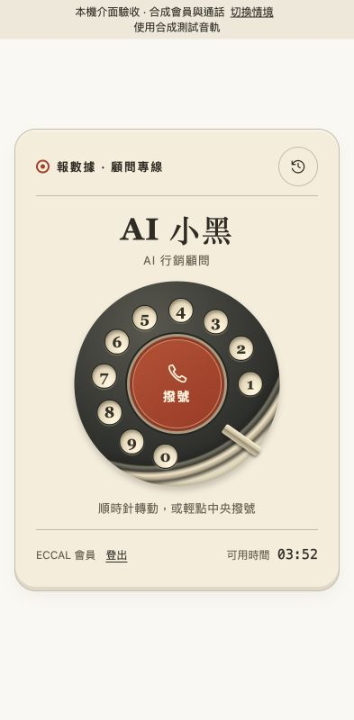
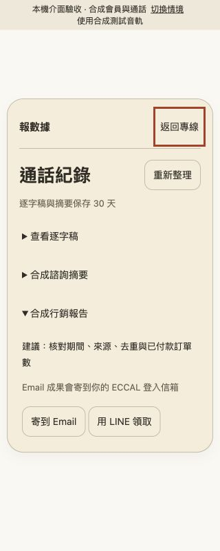
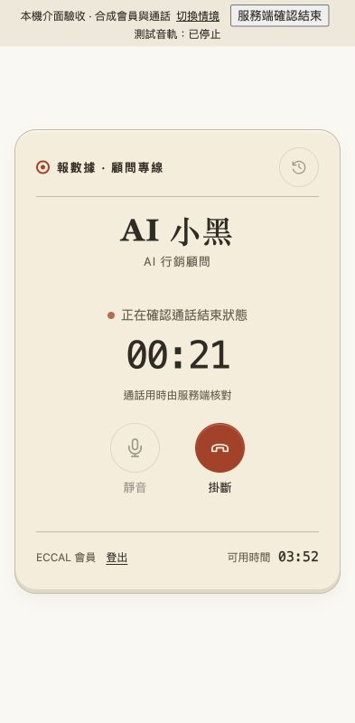

# 復古轉盤實作與驗收

日期：2026-11-06

fresh spec_evaluator 已完成獨立驗收，判定 PASS，逐項核對程式、競態回歸、25 項前端測試、完整檢查、畫面、來源 SHA-256 及交接清單

依本次使用者指令與選定的「復古轉盤」，以 main `a1efb8a` 的三份設計檔為基準，接到現有登入、額度、WebRTC、掛斷、紀錄及成果流程

## 可操作預覽

啟動 `node test/fixtures/dialer-preview-server.mjs`，開啟 [復古首頁](http://127.0.0.1:8788/?scenario=member) 或 [驗收情境列表](http://127.0.0.1:8788/__preview)

本機驗收使用合成會員、HTTP 回應與音軌，頁面上方標示測試環境。可操作轉盤、鍵盤撥號、靜音、掛斷、紀錄、成果與各種失敗情境；不呼叫正式通話及寄件服務

`npm run dev` 的 [本機 Worker](http://127.0.0.1:8787/) 提供實際產品路由。本機沒有正式 ECCAL 服務憑證，會員查核呈現服務錯誤

## 修改內容

| 檔案 | 內容 |
|---|---|
| `public/index.html` | 復古機身、中央轉盤、數字孔、會員／額度、通話控制、結束摘要及紀錄面板，保留既有 DOM 接點 |
| `public/style.css` | 沿用原型配色、尺寸、間距與轉盤視覺；補齊窄螢幕、紀錄捲動、焦點、停用及減少動態效果 |
| `public/app.js` | 兩種撥號操作共用入口；依 WebRTC 狀態切換畫面；靜音切換音訊軌；掛斷待確認時阻止重撥；紀錄、成果、Email／LINE、登出沿用既有 API |
| `src/metering.ts` | 以既有扣秒時間軸回傳顯示用時、是否已有音訊及是否等待工具 |
| `src/worker.ts` | 本人紀錄回應新增 `usage`，延用現有會員驗證與 no-store |
| `test/frontend.node.test.mjs` | 保留 15 項回歸，增加額度、轉盤防重、音軌靜音、服務端計時、結束待確認、面板焦點與四種通話競態共 10 項 |
| `test/metering.test.ts`、`test/member.test.ts` | 音訊前零秒、工具等待暫停、結算固定值與跨會員拒讀 |
| `test/fixtures/dialer-preview-server.mjs` | 只在本機啟動的受控驗收情境與合成媒體 |
| `docs/design/README.md`、本文件與 `verification/` | 選定款式、驗收清單、測試及畫面證據 |

## 資料與狀態

- 登入取自 `/auth/status`，資格及剩餘額度取自 `/api/me`，不使用原型的固定 05:00
- 開始仍由 `/api/calls` 交換 SDP，WebRTC 實際 connected 才顯示接通
- 每秒讀取本人的 `/api/calls/:id`，顯示 `usage.elapsedSeconds`；此值使用同一服務端扣秒時間軸，第一段音訊前為零，扣除重疊工具等待，結束後使用 ECCAL 結算值。瀏覽器不累加計費秒數或自行截止
- 掛斷仍先取消生成、清除播放並停止收音，等待服務端確認。待確認時保留會話並禁止重撥，收到 ended／failed 後再關閉 WebRTC、更新額度及紀錄
- 服務端已確認結束時，可由讀回結果完成掛斷；上一通的掛斷回應、紀錄或用時讀取即使延遲，也不影響新通話。發證尚未回就取消時，取得會話後仍會監看服務端的結束確認
- 紀錄面板沿用本人逐字稿、摘要、報告、廣告文案、改善計畫及交付狀態。成果深層連結開啟對應文件；Email 收件人仍為 ECCAL 登入信箱，LINE 沿用一次性領取碼

## 逐項驗收

| 交接清單 | 結果 | 證據 |
|---|---|---|
| 初始辨識、會員、可用時間及撥號 | 通過 | 原型視覺比對；HTTP 合成會員 232 秒顯示 03:52 |
| 配色、間距、操作與手機／桌面可用 | 通過 | 320／393／768／1280 截圖，無水平溢出，主要控制在畫面內 |
| 後端登入／額度與禁用規則 | 通過 | guest、zero、ineligible 實際介面讀回；自動測試未發出音訊請求 |
| 撥號、接通、失敗與防重複 | 通過 | 順時針手勢與鍵盤 Enter；逆時針、取消與隨後 click 不重撥；實際 WebRTC callback 控制接通 |
| 掛斷取消、停止音訊及後端確認 | 通過 | 既有取消／截斷回歸；pending 畫面與服務端確認後結束頁 |
| 靜音音軌、文字、ARIA 與重撥初始值 | 通過 | enabled、aria-pressed、取消靜音文字與新音軌還原測試；瀏覽器合成音軌讀回 |
| 紀錄、逐字稿、成果與深層連結 | 通過 | 320 px 報告展開、紀錄捲動、Email／LINE 回歸 |
| 麥克風拒絕、未接通、零額度與結束確認 | 通過 | 各情境畫面與狀態文字讀回 |
| 四種寬度、操作可見及無水平溢出 | 通過 | `verification/results.json` 的四組尺寸與按鈕座標 |
| 鍵盤、提示與焦點 | 通過 | Enter 撥號／掛斷、面板 Tab 循環、Escape 返回、焦點回紀錄入口，背景 inert，狀態／錯誤 live region |
| npm run check 與可操作預覽 | 通過 | 型別、179 Workers、25 前端、3 原生連線與 dry-run，全數通過 |

## 尚待處理

正式站已發布這版，測試會員補回 300 秒後，已有一通新紀錄扣 2 秒、剩餘 298 秒，首頁與 ECCAL 帳目一致。這通沒有逐字稿且有 1 段辨識失敗，語音回覆與新成果接續核對，見 [正式發布與補額紀錄](../retro-release-2026-11-06.md)

## 證據

[結構化讀回與來源 SHA-256](verification/results.json) · [完整 npm run check 結果](verification/check.log)

