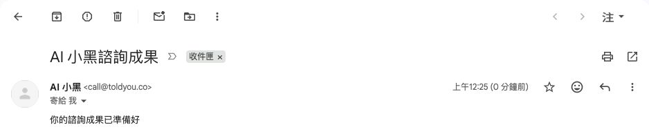
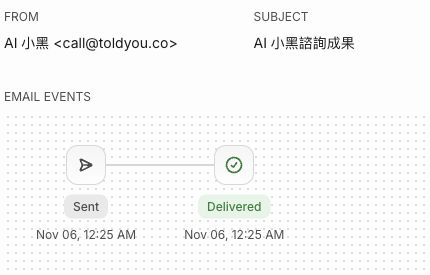
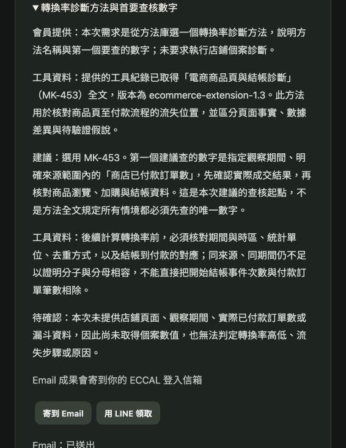

# Email 交付驗收

2026-11-06，依 [Issue #23](https://github.com/backtrue/realtime-black/issues/23)與使用者核定，以 Resend 寄到會員的 ECCAL 登入信箱 `b***@gmail.com`，完成正式實收與成果存取驗證

## 正式版本

| 項目 | 已確認的版本 |
|---|---|
| 語音站來源 | `11197d0724703a1a614b52a10b07325c06b94ad8` |
| Cloudflare version | `ac2518ba-4681-4111-ab28-46d71f1293a2`，100% 流量 |
| Cloudflare deployment | `65ce0d31-59ba-4aa8-a467-f6e2f00735bd` |
| ECCAL 實作 | `e081d9987cb13120e17a57e33d9a6d9090eb64ba` |
| ECCAL 發布提交 | `17020ceff127dec9ab4d773d2705878888b80b91`，parent 為 e081d99，0 changed files |
| ECCAL 發布 build | `10ddb496-0e38-497a-bc9e-155cc77634e0` |
| ECCAL tree | `c679ad0267bf83cd03f922d43f82c1b384f0b442`，與本機受測內容一致 |

ECCAL GitHub、Replit Git 與本機同步到發布提交，Republish 顯示 Live，提供者狀態為 success。正式 recipient 端點回傳 200、eccal-voice-v1、no-store，登入信箱與指定會員相符。語音站 app.js 為 200／no-store，SHA 與來源檔案相同

## 正式實收與存取

1. 重新以指定的 ECCAL 會員登入，從已存在的 MK-453 對話產生行銷報告「轉換率診斷方法與首要查核數字」
2. 在報告下按一次「寄到 Email」，後端工作為 succeeded；Resend 同一筆信顯示 Sent／Delivered，收件人與成果網址吻合
3. Gmail 收件匣於台灣時間 2026-11-06 00:25:42 收到「AI 小黑諮詢成果」，寄件人為 AI 小黑 <call@toldyou.co>；SPF、DKIM 皆通過。MIME 正文的成果網址逐字相符，沒有逐字稿或報告正文
4. 登出後開啟原成果網址，畫面要求登入且沒有報告內容；重新登入原會員，再開啟原信件網址，指定報告自動展開，Email 狀態仍為已送出

本次未新增通話、補發免費額度或變更既有額度。收件截圖保留 Gmail 主旨、寄件人、收件匣標記與時間，收件欄維持「我」；會員信箱、郵件、工作、通話與文件識別值於 JSON 使用遮蔽值或 SHA-256

## 未核對收件人與寄送失敗

在本機隨機 PostgreSQL schema，使用實際 Express、HttpEccalEmail、MemberEngine 與受控提供者回應，核對服務身分、本人信箱、跨會員、重送、信箱變更與網址替換。非本人信箱為 RECIPIENT_UNVERIFIED，提供者呼叫為 0

| 提供者案例 | 保存的工作狀態 | 失敗代碼 | HTTP 狀態 | 重播後提供者呼叫總數 |
|---|---|---|---|---|
| 明確拒絕 | failed | RESEND_REJECTED | 422 | 1 |
| 服務錯誤 | unknown | RESEND_UNAVAILABLE | 503 | 1 |
| 網路錯誤 | unknown | RESEND_UNAVAILABLE | 無 | 1 |
| 不合格收據 | unknown | RESEND_UNAVAILABLE | 無 | 1 |

四項實際工作快照收錄於 JSON，皆沒有成功收據，重播未重寄，提供者私有錯誤沒有進入工作。測試只使用本機合成會員與受控 Resend 回應

## 資料保留與檢查

ECCAL 發布前完成正式全庫備份。發布後、重新登入測試前，唯讀核對全部 63 張 public 表，所有筆數與逐列內容摘要完全相同，總資料 SHA-256 為 `1661b393b7f6e169d4e82751d6d3f328cc6e78d62f7db1362353378cf6bbf0e3`

語音站完整 check 通過：177 Workers、15 前端、3 原生連線、型別檢查與 dry-run；ECCAL 通過 Email 7、額度 17、跨 repo 契約 1、登入 8、型別檢查與 build。另擷取四種失敗工作快照，7 項 Email 整合測試通過

[結構化證據與工作快照](examples/email-delivery-2026-11-06.json) · [失敗工作擷取執行結果](examples/email-delivery-2026-11-06/negative-capture.tap) · [未登入畫面](examples/email-delivery-2026-11-06/login-required.png)
