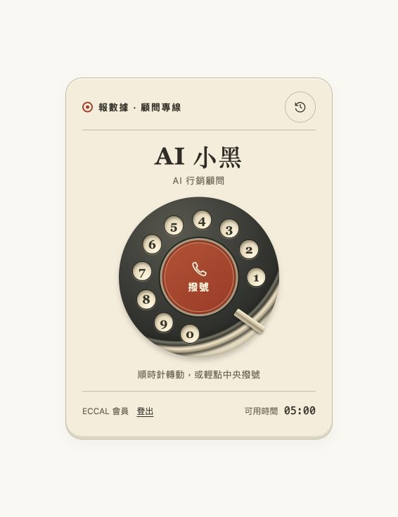
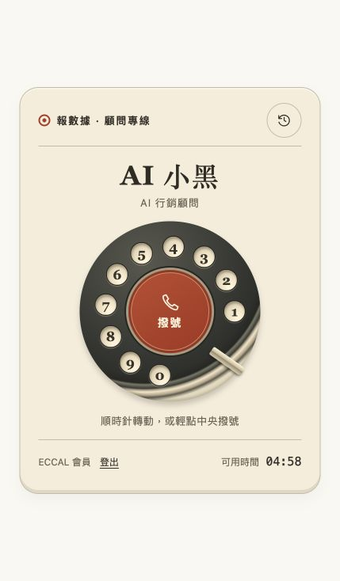

# 復古轉盤正式發布與測試補額

日期：2026-11-06

[正式入口](https://call.thinkwithblack.com) 已發布「復古轉盤」，中央點按或順時針轉動可進入既有會員語音流程

## 提交與正式版本

| 項目 | 實際版本 |
|---|---|
| Repository／分支 | backtrue/realtime-black／main |
| 功能提交 | `6d5863307b7b0021ccc04e463418059f6277d49d` |
| 發布來源 | `b647abccbd5ddcff0387c33b2b41179217450cab`，只另修正驗證 log 尾端空白 |
| Cloudflare version | `a919d0dd-99d6-4de1-b2a9-f1c996eed5cd` |
| Cloudflare deployment | `14919548-0124-49db-ab82-388411436bfd` |
| 正式流量 | 100% |
| ECCAL 現有發布 | `17020ceff127dec9ab4d773d2705878888b80b91`，build `10ddb496-0e38-497a-bc9e-155cc77634e0` |

`/`、`/app.js`、`/style.css` 均為 200／no-store，正式內容與發布來源逐位元組相同，CSP 維持現有設定。三個檔案 SHA-256、發布時間及版本見 [結構化結果](examples/retro-release-2026-11-06.json)

本機驗收為型別檢查、179 Workers、25 前端、3 原生連線測試與 Wrangler dry-run 全數通過，fresh spec_evaluator 判定 PASS，逐項交接驗收見 [復古轉盤驗收](design/dialer-validation.md)

需要回復前一版時，既有 Email 正式版本為 `ac2518ba-4681-4111-ab28-46d71f1293a2`，可執行 `npx wrangler rollback ac2518ba-4681-4111-ab28-46d71f1293a2 --message "Return to prior Email release"`。本次沒有執行正式回復；獨立測試環境的重建及回復實測見 [發布演練](deployment-rehearsal-2026-11-05.md)

## 正式會員畫面與單次補額

正式入口的既有會員登入、零額度禁用、12 筆既有紀錄及已寄送報告均可讀取。既有 68 秒通話的本人 API 回應，usage 為 68 秒、audioStarted 為 true、waitingForTool 為 false，與原始結算 68 秒相同

三位測試會員原本皆剩 0 秒。依使用者「你幫我補足」核准，本次對目前登入的測試會員 A 補回 300 秒，調整收據為 `retro-dialer-test-credit-20261106-A`。既有總額欄位維持 300 秒，當前額度使用計數由 300 降至 0；原始通話占用、扣秒與結算收據完整保留，這次補額另留 prepared／committed 收據

執行前完成全庫 3,777,881 bytes、0600 備份，使用相同 PostgreSQL snapshot 在本機還原，63 張 public 表的筆數及內容摘要全部相同。備份 SHA-256 為 `30be7698ec1affb68123d5e7947bfb8677250b9fdd8d0248a46665faa30be7bb`，測試還原庫已清理

補額在 Replit 外以單次交易執行，核對固定會員、Email、預期帳目、無進行中通話及同會員列鎖，再以 guarded update 更新一列。交易前後核對其他會員及全部資料表，只變更目標額度計數；其餘 62 表包含所有 voice_reservations 的筆數與內容摘要均相同。ECCAL source、schema 與 Replit 發布版本維持現有版本

本機 5 項補額驗證與 fresh spec_evaluator 執行前、執行後核對均 PASS。正式 ECCAL balance 回應 200／eccal-voice-v1／no-store，剩餘 300 秒，完整重新整理首頁後顯示 05:00 且中央撥號可用

## 新通話驗收

正式會員已有一通新紀錄：台灣時間 19:18:47 建立、19:18:54 結束，總經過時間 6.617 秒，服務端音訊計時與 ECCAL 均扣 2 秒，剩餘 298 秒。只有一筆新占用，原始結算累計為 302 秒，扣除本次 300 秒測試 credit 後，當前額度使用計數為 2 秒，帳目一致；另外兩位會員仍為 0 秒

結束畫面顯示本次使用 00:02，首頁顯示 04:58，紀錄增為 13 筆。這通逐字稿為 0 段、語音辨識失敗 1 段、成果為 0 份，正在核對使用者實際聽到的結果，Issue #29 保持開啟

剩餘 Issue 的自動驗證及待決項見 [實作狀態](implementation-status.md)：#6 待兩分頁與兩台實際裝置，#13 待本人教學口吻試聽，#24／#27 待指定 LINE 官方帳號與實收，#30 後續待本人聲音、付費與資料來源契約
